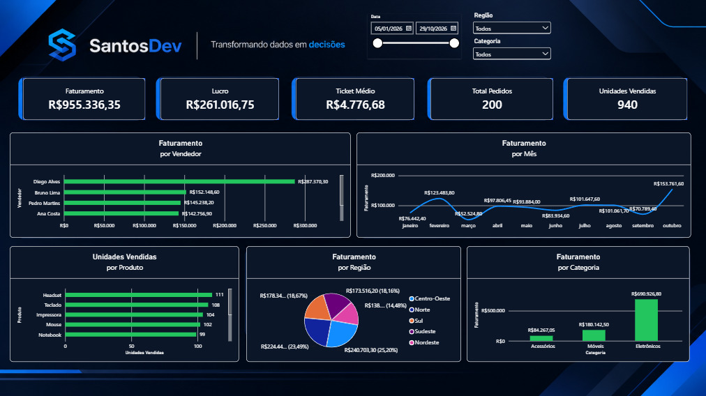

# Dashboard de Análise de Vendas


Dashboard de vendas que montei no Power BI a partir de uma base em Excel. A ideia foi pegar uma planilha simples de pedidos e transformar em um painel onde dá pra ver, em poucos segundos, quanto a empresa faturou, quanto lucrou, quem vendeu mais e onde estão as vendas.



## O que o painel mostra

**Indicadores principais**

| Faturamento | Lucro | Ticket Médio | Total de Pedidos | Unidades Vendidas |
|---|---|---|---|---|
| R$ 955.336,35 | R$ 261.016,75 | R$ 4.776,68 | 200 | 940 |

**Visuais**

- Faturamento por vendedor
- Faturamento por mês (janeiro a outubro de 2026)
- Unidades vendidas por produto
- Faturamento por região
- Faturamento por categoria

**Filtros:** período (data), região e categoria. Todos os visuais respondem aos filtros juntos.

## Alguns pontos que os dados mostram

- **Eletrônicos** responde pela maior parte do faturamento (~R$ 690 mil), bem à frente de Móveis e Acessórios.
- **Diego Alves** é o vendedor com maior faturamento, quase o dobro do segundo colocado.
- O **Sudeste** lidera entre as regiões, com cerca de 25% do total.
- O faturamento oscila ao longo do ano, com queda em março e o pico em outubro.

## Base de dados

O arquivo [`Base_Vendas.xlsx`](Base_Vendas.xlsx) tem 200 pedidos com as colunas:

`Data` · `Pedido` · `Produto` · `Categoria` · `Região` · `Vendedor` · `Quantidade` · `Preço Unitário` · `Custo Unitário`

Faturamento, lucro e ticket médio foram calculados no Power BI com medidas DAX, a partir de quantidade, preço e custo.

## Layout

Antes de abrir o Power BI, desenhei o fundo do painel com a identidade visual da SantosDev e já deixei definido onde ficaria cada bloco: cinco cards de KPI no topo, dois gráficos maiores no meio e três na parte de baixo.


## Ferramentas

- **Excel** – organização e preparação da base
- **Power BI Desktop** – modelagem, medidas DAX e visualizações
- **Power Query** – tratamento dos dados antes de carregar no modelo
- **Figma / Canva** – criação do fundo e do layout do painel

## Como abrir

1. Baixe ou clone o repositório:
   ```bash
   git clone https://github.com/santosdev/dashboard-analise-de-vendas.git
   ```
2. Abra o arquivo `Dashboard_SantosDev.pbix` no Power BI Desktop.
3. Se pedir para atualizar a fonte de dados, aponte para o `Base_Vendas.xlsx` da pasta.

## Estrutura

```
dashboard-analise-de-vendas/
├── Base_Vendas.xlsx           # base de dados
├── Dashboard_SantosDev.pbix   # arquivo do Power BI
├── Escopo_Dashboard.png       # layout/fundo do painel
└── ImagemDashboard.jpeg       # print do dashboard final
```

## Autor

Feito por **Fabio Henrique Martins** — SantosDev.

[](https://github.com/santosdev)
